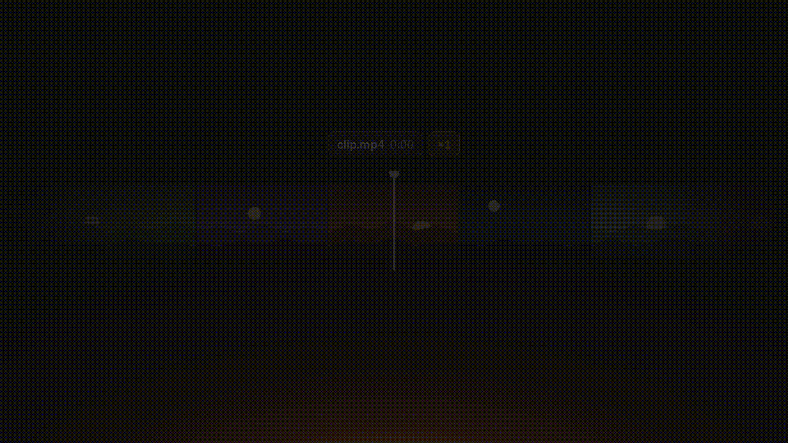
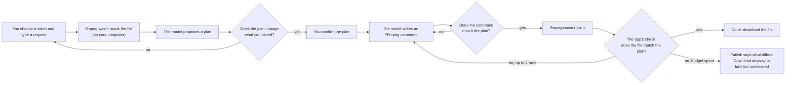

<p align="center">
  
</p>

# ffwd-web

**Describe a video chore in one sentence. ffwd does it on your own computer, then checks the result against what you asked.**

This is the website and the browser app for ffwd. A 0.6B model (ffwd-0.6b) runs inside your browser tab (WebGPU, or the processor as a fallback), writes an FFmpeg command for your request, and ffmpeg.wasm runs it on your file. Your video never leaves your computer. The result is only called done when an automatic check, run by the app and not by the model, passes.

The model, its training, the evaluation and the protocol live in the separate `ffmpeg-agent` repository.

> [!IMPORTANT]
> **Early preview (version 0.9.0).** The model, ffwd-0.6b v1.0.0, is final for this release, but this web app is an early preview.
> **Known limitation:** vague or ambiguous real-world requests may not be handled correctly. The owner's own example: asking it, on a real clip, "Make the video potrait mode, lower the volume" did not produce a correct result (the cause has not been investigated). Clear, specific requests such as "cut the first 3 seconds" or "make it 720p" work best. The reported accuracy is measured on generated tasks, not on real users' wording, so real-world accuracy is unknown.
> When a plan changes nothing, or does not cover something your request mentions, the app says so before running. When a result does not match its plan, the app says that too and never shows it as done.

## Contents

- [How it works](#how-it-works)
- [Quick start](#quick-start)
- [Commands](#commands)
- [Build-time settings](#build-time-settings)
- [Testing](#testing)
- [Testing the exact release package](#testing-the-exact-release-package)
- [Deploying](#deploying)
- [Repository layout](#repository-layout)
- [Privacy](#privacy)
- [Known limits](#known-limits)
- [Licence](#licence)

## How it works



- The model never sees real file names or paths; the app maps IDs to your file.
- Every FFmpeg argument list passes an allow-list validator before it runs. The app never runs a shell string.
- The model runs with wllama (llama.cpp in WebAssembly). A short check on first use decides between WebGPU and the processor and remembers the answer on your device.
- The first time, the model file (about 444 MB) is downloaded once, after you agree, and kept in your browser.

## Quick start

Prerequisites: Node.js 24 and pnpm 12.13.0 (the repository pins it in `package.json`; with Corepack, `corepack enable` picks it up). A recent Chromium-based browser. WebGPU is optional.

```bash
git clone <this repository>
cd ffwd-web
pnpm install
pnpm copy-core      # copies the 31 MB ffmpeg core into public/ffmpeg (git-ignored)
pnpm dev
```

`pnpm dev` has no model, so the app says the model is not published yet. To use the real model, build the exact release package (see below).

## Commands

| Command | What it does |
| --- | --- |
| `pnpm dev` | Development server. |
| `pnpm build` | Production build into `build/client` (static, prerendered pages) and writes `build/build-info.json`. |
| `pnpm preview` | Serves the build with the same isolation headers. |
| `pnpm lint` | ESLint and Prettier check. |
| `pnpm test` | Unit tests (Vitest). |
| `pnpm test:build` | Builds, then checks the build output. |
| `pnpm e2e` | End-to-end tests (Playwright) with a scripted model and real ffmpeg.wasm. |
| `pnpm size` | Bundle size budget (120 kB gzip for the first load of the home and chore pages). |
| `pnpm check:release` | Fails on anything that is not ready for a hosted launch. Run it in the same shell as `pnpm build`. |
| `pnpm release:local` | Serves a local model release package and a production build of the app against it. |
| `pnpm copy-core` | Copies the ffmpeg core into `public/ffmpeg`. |

## Build-time settings

All are optional in development. A hosted build needs the first three or `pnpm check:release` fails.

| Variable | Meaning |
| --- | --- |
| `VITE_MODEL_MANIFEST_URL` | https URL of `ffwd-model.json` at a pinned tag or commit (never `main`), for example `https://huggingface.co/<owner>/ffwd-0.6b/resolve/v1.0.0/ffwd-model.json`. |
| `VITE_MODEL_MANIFEST_SHA256` | sha256 of that exact manifest file. The app refuses a manifest that does not match. |
| `VITE_FFMPEG_CORE_BASE` | https URL (no trailing slash) of the host serving the three ffmpeg core files. Needed on Cloudflare Pages, whose limit is 25 MiB per file. Unset means the site's own `/ffmpeg`. |
| `VITE_SITE_URL` | The site's public address (canonical links and the sitemap). |
| `VITE_FEEDBACK_URL` | https URL of the opt-in feedback Worker. Unset means the feedback feature is off. |
| `VITE_POSTHOG_KEY` | Switches analytics on. `pnpm check:release` fails if it is set unless `FFWD_ANALYTICS_ON=1`. |

The app refuses a model whose `protocol_version` differs from `protocol/PIN.json`, whose `min_app_version` is above the app version (`package.json`), or whose prompt or chat template differs from the app's own. Nothing is downloaded in that case.

## Testing

```bash
pnpm lint
pnpm test          # about 1,080 unit tests
pnpm test:build
pnpm size
pnpm e2e           # needs the FFmpeg 5.1.1 static build for some specs, see CI
```

The continuous integration workflow (`.github/workflows/ci.yml`) runs the same checks on every push. The real-model tests (`pnpm test:browser-gguf`, `scripts/app-smoke.mjs`) need the model file, a GPU or a patient processor, and a memory cap; they are not run in CI.

## Testing the exact release package

```bash
pnpm release:local
```

This checks the release package against its `SHA256SUMS`, serves it on `http://localhost:8765`, builds the production app against it, and serves that on `http://localhost:4180/app`. Open it in a Chromium-based browser. The first visit downloads the model and runs the graphics check; later visits use the stored answer. The build is stamped as a local test, so `pnpm check:release` refuses it.

## Deploying

The site is static and is designed for Cloudflare Pages. `docs/launch-items.txt` is the checklist of what `pnpm check:release` fails on and what to do about each item (hosting the ffmpeg core on R2, the pinned model manifest, analytics, the feedback Worker, placeholder text).

## Repository layout

```
app/                 the React Router app: pages, the /app tool, components, styles
app/agent/           JavaScript port of the agent loop, checker, validator and chat template
app/model/           the model runtime: worker, client, manifest reader, graphics check and path choice
app/tool/            tool state, analytics bridge, plan chips
protocol/            a pinned copy of the shared protocol (schemas, allow-list, conformance cases)
public/              static files, including _headers (isolation and security headers)
scripts/             postbuild, release checks, the local release server, smoke tests, protocol sync
tests/               unit, build and end-to-end tests
workers/feedback/    the opt-in feedback receiver (Cloudflare Worker and D1), not deployed by default
docs/                launch notes
```

## Privacy

- Your video, file names and file contents never leave your computer.
- Analytics are off unless a key is set at build time. Events contain only categories and numbers; nothing loads when the browser sends Do Not Track or Global Privacy Control. When on, an anonymous random id is kept in this browser's local storage; no cookies are used.
- Feedback is opt-in and separate from analytics: nothing is sent unless you click Send, you see the exact message first, and it contains the request text (with your file's name removed), the plan and a failure category, never your video or file names.
- The privacy page on the site states all of this in plain words.

## Known limits

- Speed and accuracy depend on the device. WebGPU on one tested Intel integrated graphics chip gave wrong output on long prompts, so the app checks WebGPU once and falls back to the processor when it fails.
- Browser accuracy is 95.0% (855/900) on generated test tasks, 1.33 percentage points below the native file; the model repository has the full evaluation and its limits.
- The ffmpeg core (31 MB) exceeds Cloudflare Pages' file limit and must be hosted elsewhere (`VITE_FFMPEG_CORE_BASE`).

## Licence

GPL-3.0-only (`LICENSE`). Third-party software, fonts and media: `THIRD_PARTY_NOTICES.md` and `CREDITS.md` (Meridian by Netflix, CC BY 4.0, modified).
